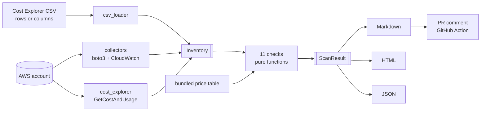

# aws-cost-sentinel

> Personal learning project, built pairing with Claude Code. Every company, person and number here is made up.

[](https://github.com/builtbyshailendra/aws-cost-sentinel/actions/workflows/ci.yml)


Find AWS cost waste from a Cost Explorer export or a live account, put a monthly
dollar figure and a confidence level on every finding, and post the result on a
pull request.

## What has and has not been run

- **The live AWS scan has never run against a real AWS account.** `cost-sentinel scan`
  and the collectors are tested only against [moto](https://github.com/getmoto/moto)
  (mocked AWS, in memory), and the Cost Explorer API only against
  `botocore.stub.Stubber` responses. Real IAM edge cases, throttling and real
  CloudWatch data have not been seen.
- **The CSV demo uses synthetic data.** `examples/cost_explorer_by_*.csv` are invented
  Cost Explorer exports, not a real bill, so the $1,302.11 below is a made-up number.
- **The moto demo account is invented too**: one example of each kind of waste,
  seeded by `scripts/demo_moto_scan.py`.
- **The GitHub Action has run on GitHub in CSV mode only**: the
  [Cost report](.github/workflows/cost-report.yml) workflow runs it against the
  synthetic CSV on every push to `main`, writing the job summary and a report artifact.
  Its `scan` mode and its pull request comment have not run on GitHub yet.
- The bundled price table approximates AWS's public us-east-1 list prices (table
  version `2025-06`); it has not been checked against a real invoice.
- The test suite blocks every outbound network connection, so no test can reach AWS.

## Problem

Most AWS accounts carry a steady layer of spend that nobody decided to keep: volumes
left behind by terminated instances, Elastic IPs billed by the hour, load balancers
in front of nothing, snapshots from projects that ended last year, gp2 volumes that
would be 20% cheaper as gp3, NAT gateways pushing S3 traffic that a free gateway
endpoint would carry, and on-demand baselines that a Savings Plan would discount.
Cost Explorer shows the totals but not which resources to delete, and Trusted
Advisor's cost checks need a Business support plan. `aws-cost-sentinel` is a small,
read-only tool that turns either a Cost Explorer CSV export or a boto3 scan into a
ranked list of concrete fixes with an estimated monthly saving, and can run in CI so
the report shows up where infrastructure changes are reviewed.

## Architecture



Collectors are the only code that talks to AWS. They turn API responses into frozen
dataclasses (`Inventory`); checks read the inventory and the price table and return
`Finding` objects; report writers render a `ScanResult`. The CSV path produces the
same `Inventory` with only cost data attached, so both inputs share the scanner,
writers, CLI and GitHub Action. More detail, the per-check data sources and the IAM
policy are in [docs/ARCHITECTURE.md](docs/ARCHITECTURE.md).

## Checks

| Id | Finds | Savings estimate | Confidence |
|---|---|---|---|
| `idle-ec2` | Running on-demand instances with average CPU below the threshold | Full on-demand price | high if CPU < half the threshold and older than the lookback |
| `unattached-ebs` | Volumes in the `available` state | Full volume price incl. provisioned IOPS/throughput | high after 7 days |
| `old-snapshots` | Snapshots older than N days not referenced by an AMI | 50% of the full-size snapshot price (incremental) | medium if the source volume is gone |
| `unused-eip` | Unassociated Elastic IPs, or IPs on stopped instances | $0.005/hour | high / medium |
| `idle-load-balancer` | ALB/NLB/GWLB with no healthy targets | Hourly charge (LCUs excluded) | high with no registered targets |
| `nat-gateway` | Idle NAT gateways, and busy ones whose processing charge exceeds the hourly charge | Hourly charge if idle, 30% of processing if busy | high / medium / low |
| `gp2-to-gp3` | gp2 volumes, keeping the gp2 IOPS baseline on gp3 | Price difference | high up to 1 TiB |
| `idle-rds` | Available instances with < 1 average connection and low CPU | Instance hours (storage kept) | high with zero connections |
| `s3-lifecycle` | Buckets with no enabled lifecycle rule | 30% of Standard data moved to Standard-IA | low |
| `savings-plan` | Steady on-demand compute (instances up > 30 days, or the minimum recent EC2 spend) | 20% of the baseline | medium / low |
| `spend-growth` | Services whose latest month is 25%+ above the trailing average | The increase (to investigate) | low |

Every estimate uses the bundled price table: us-east-1 on-demand list prices with a
regional multiplier ([ADR 0001](docs/adr/0001-bundled-price-table.md)). Treat the
numbers as approximate and use them to rank work, not to forecast a bill.

## Quickstart

Requires Python 3.12 and [uv](https://docs.astral.sh/uv/).

```bash
git clone https://github.com/builtbyshailendra/aws-cost-sentinel.git
cd aws-cost-sentinel
uv venv .venv
uv pip install -e ".[dev]"            # on Windows: uv pip install --python .venv/Scripts/python.exe -e ".[dev]"
source .venv/bin/activate              # on Windows: .venv\Scripts\activate

# Offline: analyse the bundled Cost Explorer export (no AWS credentials needed)
cost-sentinel report --csv examples/cost_explorer_by_service.csv

# Live: scan one region with a named profile
cost-sentinel scan --profile X --region Y
```

## Usage

```console
$ cost-sentinel --help
usage: cost-sentinel [-h] [--version] [--log-level {DEBUG,INFO,WARNING,ERROR}]
                     COMMAND ...

Find AWS cost waste and estimate the monthly savings of fixing it.

positional arguments:
  COMMAND
    scan                scan a live AWS account with boto3
    report              analyse a Cost Explorer CSV export (no AWS access
                        needed)
    checks              list the available checks
    comment             post or update a Markdown report as a pull request
                        comment

options:
  -h, --help            show this help message and exit
  --version             show program's version number and exit
  --log-level {DEBUG,INFO,WARNING,ERROR}
                        logging verbosity on stderr (default: WARNING)

$ cost-sentinel checks
idle-ec2            Idle EC2 instances [inventory]
unattached-ebs      Unattached EBS volumes [inventory]
old-snapshots       Old EBS snapshots [inventory]
unused-eip          Unused Elastic IPs [inventory]
idle-load-balancer  Load balancers with no healthy targets [inventory]
nat-gateway         NAT gateway spend [inventory]
gp2-to-gp3          gp2 volumes convertible to gp3 [inventory]
idle-rds            Idle RDS instances [inventory]
s3-lifecycle        S3 buckets without lifecycle rules [inventory]
savings-plan        Savings Plan opportunity [inventory or cost data]
spend-growth        Services with unexplained spend growth [cost data]
```

`cost-sentinel scan --help` and `cost-sentinel report --help` list the per-command
flags; they are also summarised in [Configuration](#configuration).

### Offline report from a Cost Explorer export

Export from Cost Explorer with **Group by: Service** and monthly granularity. Both
layouts the console produces are accepted: services as rows
([example](examples/cost_explorer_by_service.csv)) or services as columns
([example](examples/cost_explorer_by_month.csv)).

```console
$ cost-sentinel report --csv examples/cost_explorer_by_service.csv
```

```markdown
# AWS Cost Sentinel report

Generated 2026-11-27 07:35 UTC | region `global` | source `csv` (examples/cost_explorer_by_service.csv)

**Estimated monthly savings: $1,302.11** across 3 finding(s) (0 high, 1 medium, 2 low confidence).

## Summary by check

| Check | Findings | Est. monthly savings |
|---|---:|---:|
| Savings Plan opportunity (`savings-plan`) | 1 | $851.02 |
| Services with unexplained spend growth (`spend-growth`) | 2 | $451.09 |

## Findings

### Savings Plan opportunity ($851.02/month)

| Resource | Region | Monthly cost | Savings | Confidence | Why | Recommendation |
|---|---|---:|---:|---|---|---|
| `EC2-Instances` | global | $4,255.10 | $851.02 | medium | EC2-Instances spend never dropped below $4,255.10 per month over the last 3 months, which looks like steady on-demand usage | Check Cost Explorer's Savings Plans recommendations and commit to the baseline with a 1-year, no-upfront Compute Savings Plan. |

### Services with unexplained spend growth ($451.09/month)

| Resource | Region | Monthly cost | Savings | Confidence | Why | Recommendation |
|---|---|---:|---:|---|---|---|
| `EC2-Other` | global | $1,048.65 | $380.27 | low | 2026-10 cost $1,048.65 against a trailing average of $668.38 (+57%) | Open Cost Explorer for this service grouped by usage type and linked account to confirm the increase is intended; set an AWS Budgets alert at the trailing average. |
| `CloudWatch` | global | $168.92 | $70.82 | low | 2026-10 cost $168.92 against a trailing average of $98.10 (+72%) | Open Cost Explorer for this service grouped by usage type and linked account to confirm the increase is intended; set an AWS Budgets alert at the trailing average. |

## Spend by service (2026-05 to 2026-10)

| Service | 2026-10 | Avg of earlier months | Trend | Total |
|---|---:|---:|---:|---:|
| EC2-Instances | $4,318.90 | $4,249.40 | +2% | $25,565.90 |
| Relational Database Service | $1,862.30 | $1,841.37 | +1% | $11,069.15 |
| EC2-Other | $1,048.65 | $668.38 | +57% | $4,390.55 |
| S3 | $463.35 | $416.44 | +11% | $2,545.53 |
| Elastic Load Balancing | $172.45 | $169.33 | +2% | $1,019.09 |
| VPC | $125.54 | $121.17 | +4% | $731.40 |
| CloudWatch | $168.92 | $98.10 | +72% | $659.40 |
| Lambda | $45.61 | $43.06 | +6% | $260.93 |
| DynamoDB | $31.20 | $27.72 | +13% | $169.81 |
| Key Management Service | $12.00 | $12.00 | +0% | $72.00 |
| **All services** | **$8,257.43** | **$7,655.47** | | **$46,534.79** |

## Notes

- Prices come from the bundled table (version 2025-06, us-east-1 list prices with a regional multiplier). Treat every figure as an estimate.
- A Cost Explorer export has no resource ids, so only the savings-plan and spend-growth checks run; use 'cost-sentinel scan' for resource-level findings.
- Confidence reflects how likely the saving is real, not how precise the number is.
- The total counts each resource once: when several checks flag the same resource, only the largest saving is added, and the Savings Plan baseline leaves out idle instances.
```

The CSV has no resource ids, so only `savings-plan` and `spend-growth` can run in
this mode. Write HTML or JSON instead with `--format html --output report.html`.
Rendered examples of all three formats are in [examples/reports](examples/reports).

### Live scan without an AWS account

`scripts/demo_moto_scan.py` seeds an in-memory moto account with one example of each
kind of waste (idle m5.xlarge, orphaned volume, old snapshot, spare Elastic IP, ALB
with no targets, busy NAT gateway, idle Multi-AZ RDS, bucket without lifecycle
rules), moves the scan clock 120 days ahead and runs the same collectors and checks
as `cost-sentinel scan`:

```console
$ python scripts/demo_moto_scan.py
```

```markdown
# AWS Cost Sentinel report

Generated 2026-11-27 07:36 UTC | region `us-east-1` | source `live` (moto demo account, resources back-dated 120 days)

**Estimated monthly savings: $622.01** across 12 finding(s) (7 high, 3 medium, 2 low confidence).

## Summary by check

| Check | Findings | Est. monthly savings |
|---|---:|---:|
| Idle RDS instances (`idle-rds`) | 1 | $318.28 |
| Idle EC2 instances (`idle-ec2`) | 1 | $140.16 |
| NAT gateway spend (`nat-gateway`) | 1 | $60.75 |
| Unattached EBS volumes (`unattached-ebs`) | 1 | $40.00 |
| gp2 volumes convertible to gp3 (`gp2-to-gp3`) | 3 | $22.82 |
| Load balancers with no healthy targets (`idle-load-balancer`) | 1 | $16.43 |
| Savings Plan opportunity (`savings-plan`) | 1 | $12.41 |
| Old EBS snapshots (`old-snapshots`) | 1 | $5.00 |
| Unused Elastic IPs (`unused-eip`) | 1 | $3.65 |
| S3 buckets without lifecycle rules (`s3-lifecycle`) | 1 | $2.52 |
```

CI runs this demo on every push and checks the $622.01 total.

The full output, including every finding, is in
[examples/reports/live-scan-demo.md](examples/reports/live-scan-demo.md) (also as
[HTML](examples/reports/live-scan-demo.html) and [JSON](examples/reports/live-scan-demo.json)).

### Live scan

Not yet run against a real account (see the top of this README). This is the
intended usage:

```bash
cost-sentinel scan --profile prod-readonly --region eu-west-1 \
  --lookback-days 30 --cpu-threshold 3 --min-savings 5 \
  --format html --output reports/eu-west-1.html
```

Services the role cannot read are listed under **Skipped** in the report instead of
failing the scan. `--no-cost-explorer` avoids the Cost Explorer API, which AWS bills
per request.

### CI gate and pull request comment

```bash
cost-sentinel report --csv examples/cost_explorer_by_service.csv --fail-above 1000
echo $?   # 3: estimated savings are above the gate
```

The composite action in [action/](action/README.md) runs a scan, writes the report
to the job summary, uploads Markdown/HTML/JSON artifacts and keeps one up-to-date
comment on the pull request:

```yaml
- uses: aws-actions/configure-aws-credentials@v4
  with:
    role-to-assume: arn:aws:iam::123456789012:role/cost-sentinel-readonly
    aws-region: eu-west-1
- uses: builtbyshailendra/aws-cost-sentinel/action@main
  with:
    mode: scan
    aws-region: eu-west-1
    fail-above: "500"
```

This repository dogfoods it in [.github/workflows/cost-report.yml](.github/workflows/cost-report.yml)
against the bundled CSV on every push to `main` and on pull requests. Only that CSV
mode has run on GitHub; the `scan` example above and the pull request comment have not.

### As a library

```python
from cost_sentinel.models import ScanConfig
from cost_sentinel.report import render
from cost_sentinel.scanner import scan_csv

result = scan_csv("examples/cost_explorer_by_month.csv", ScanConfig(min_savings=50))
print(f"{len(result.findings)} findings, ${result.total_savings:,.2f}/month")
print(render(result, "json"))
```

## Configuration

Command-line flags win over environment variables, which win over defaults. See
[.env.example](.env.example).

| Flag | Environment variable | Default | Meaning |
|---|---|---|---|
| `--profile` | `AWS_PROFILE` | default chain | AWS profile for `scan` |
| `--region` | `AWS_REGION` / `AWS_DEFAULT_REGION` | none (required for `scan`) | Region to scan |
| `--lookback-days` | `COST_SENTINEL_LOOKBACK_DAYS` | `14` | CloudWatch window for CPU, connections and NAT traffic |
| `--cpu-threshold` | `COST_SENTINEL_CPU_THRESHOLD` | `5` | Average CPU % under which an EC2 instance is idle |
| `--snapshot-age-days` | `COST_SENTINEL_SNAPSHOT_AGE_DAYS` | `90` | Snapshots older than this are reported |
| `--months` | `COST_SENTINEL_MONTHS` | `6` | Months of Cost Explorer history |
| `--format` | `COST_SENTINEL_FORMAT` | `markdown` | `markdown`, `md`, `html` or `json` |
| `--log-level` | `COST_SENTINEL_LOG_LEVEL` | `WARNING` | Log verbosity on stderr |
| `--checks` | | all | Comma-separated check ids |
| `--min-savings` | | `0` | Hide findings below this many dollars per month |
| `--savings-plan-discount` | | `0.20` | Assumed Compute Savings Plan discount |
| `--fail-above` | | off | Exit with code 3 above this monthly saving |
| `--no-cost-explorer` | | off | Skip `GetCostAndUsage` in `scan` |
| `comment --token` | `GITHUB_TOKEN` | | Token for the PR comment |
| `comment --repo` | `GITHUB_REPOSITORY` | | `owner/name` |
| `comment --pr` | `GITHUB_EVENT_PATH` | | PR number, read from the event payload in Actions |

Exit codes: `0` success, `1` input/AWS/GitHub error, `2` invalid arguments,
`3` savings above `--fail-above`.

Further thresholds (RDS connection threshold, NAT idle threshold, S3 tierable share,
snapshot incremental ratio, Savings Plan minimum uptime) live in
`cost_sentinel.models.ScanConfig` and can be set when using the library.

## Testing

```bash
.venv/Scripts/python.exe -m pytest -q          # Linux/macOS: .venv/bin/python -m pytest -q
.venv/Scripts/python.exe -m ruff check .
make cov                                        # coverage report
```

```console
$ .venv/Scripts/python.exe -m pytest -q --cov=cost_sentinel
........................................................................ [ 66%]
.....................................                                    [100%]
...
TOTAL                                      1785     87    476     53    93%
109 passed in 12.48s
```

That run is from a Windows laptop (Python 3.12.10); without coverage the suite takes
about 7.6 seconds. Most of the runtime is moto starting its in-memory services; the
checks themselves run in milliseconds.

No test touches the network or needs credentials: an autouse fixture in
`tests/conftest.py` blocks every outbound connection and DNS lookup, and
`tests/test_no_network.py` checks that a boto3 call outside moto fails. The
collectors and checks run against [moto](https://github.com/getmoto/moto) (EC2, EBS,
ELBv2, RDS, S3, CloudWatch), Cost Explorer responses are stubbed with
`botocore.stub.Stubber`, and the GitHub client takes an injectable transport. CI runs
ruff and the tests on `ubuntu-latest` and `windows-latest` with Python 3.12 and pinned
tool versions, runs the moto demo, and uploads coverage XML.

## Design decisions

- **Bundled prices, not the Pricing API.** No extra IAM permission, no extra calls,
  deterministic tests. Estimates carry an `approximate` flag when a regional
  multiplier or size extrapolation was used. See
  [ADR 0001](docs/adr/0001-bundled-price-table.md).
- **Collect once, check many.** Checks are pure functions over an inventory, so a
  scan makes one pass over each API and the CSV path reuses everything downstream.
  See [ADR 0002](docs/adr/0002-pure-checks-over-an-inventory.md).
- **Confidence next to every dollar figure.** An unassociated Elastic IP and a
  hypothetical S3 tiering saving are not the same kind of number; the report says so
  instead of summing them silently.
- **Degrade, do not abort.** A missing permission on one service becomes a "Skipped"
  line; the rest of the report is still useful.
- **Standard library for GitHub.** The PR comment uses `urllib`, so the action
  installs nothing beyond boto3. Re-runs edit one marked comment.
- **Read-only by design.** The tool never modifies resources; every recommendation is
  for a human to apply.

## Limitations

- Prices are approximate list prices (table version `2025-06`): no Windows or
  commercial database licences, no existing Reserved Instance or Savings Plan
  coverage, no EDP discounts, regional prices via a multiplier.
- One region per `scan` run; run it per region (or in a matrix job) for full
  coverage. S3 bucket sizes are only read for buckets in the scanned region.
- CSV mode only supports the `savings-plan` and `spend-growth` checks, because a
  service-level export has no resource ids.
- Idle detection relies on CloudWatch averages; a nightly batch job with a low
  average CPU will be flagged. Use `--cpu-threshold` and tags to judge.
- Load balancer savings exclude LCU charges; NAT savings for busy gateways assume
  30% of processed traffic can move to VPC endpoints.
- The inventory is held in memory; accounts with very large snapshot counts will use
  noticeable memory.
- The Docker image is not built locally in this repository's development setup; it
  is built and smoke-tested in CI (`docker` job in `ci.yml`). The image is a CLI and
  exits after each run, so it has no HEALTHCHECK and there is no compose file.

## Docker

```bash
docker build -t aws-cost-sentinel .
docker run --rm -v "$PWD/examples:/data:ro" aws-cost-sentinel report --csv /data/cost_explorer_by_service.csv
docker run --rm -v "$HOME/.aws:/home/sentinel/.aws:ro" aws-cost-sentinel scan --profile X --region Y
```

## Roadmap

- Multi-region and multi-account (AWS Organizations) scans in one run.
- Optional live pricing through `pricing:GetProducts` behind the same `Price` interface.
- Cost and Usage Report (CUR 2.0) Parquet input for resource-level CSV analysis.
- More checks: idle ElastiCache and OpenSearch, old-generation instance families,
  CloudWatch Logs groups without retention, unused EFS file systems.
- Suppression file (`.cost-sentinel.yml`) to accept known findings by resource id or tag.

## License

[MIT](LICENSE) (c) 2026 Shailendra Singh
