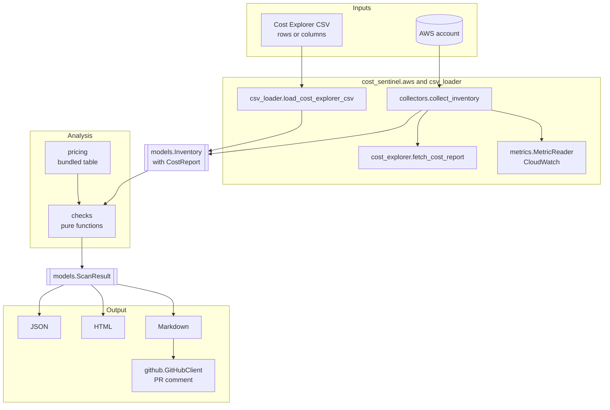

# Architecture

`aws-cost-sentinel` is a pipeline of four layers with one data model in the middle.
Only the collectors know about boto3; everything after them works on plain
dataclasses, which is what makes the checks fast and easy to test.



## Layers

| Module | Responsibility |
|---|---|
| `csv_loader` | Detects the export orientation from the header and first column, drops total rows and columns, strips `($)` suffixes, sums duplicate services and returns a `CostReport` with `YYYY-MM` periods. |
| `aws.session` | Builds a boto3 session and one client per service with adaptive retries. Cost Explorer is always called in `us-east-1`. |
| `aws.metrics` | `MetricReader` answers "average or sum of this metric over the lookback". It picks a period that keeps the call under CloudWatch's 1,440-datapoint limit and returns `None` for missing data. |
| `aws.cost_explorer` | `GetCostAndUsage` grouped by `SERVICE`, monthly, following `NextPageToken`. |
| `aws.collectors` | Turns boto3 responses into frozen dataclasses. Each service is collected inside a guard, so a missing IAM permission becomes a "Skipped" line in the report instead of a crash. |
| `checks` | Eleven `BaseCheck` subclasses. A check receives `(Inventory, ScanConfig)` and returns `Finding` objects; it never calls AWS. |
| `pricing` | Bundled on-demand list prices plus regional multipliers. Returns `Price(amount, approximate, note)` so checks can lower confidence for extrapolated prices. |
| `scanner` | Selects checks, runs them, applies `min_savings` and sorts findings by savings, then confidence. |
| `report` | Markdown, self-contained HTML (inline CSS, no scripts, escaped content) and JSON (`schema_version: 1`). |
| `github` | Standard-library REST client that creates or edits one marked comment per pull request. |
| `cli` | `argparse` front end; maps errors to exit codes. |

## Confidence model

Every finding carries a confidence level that says how likely the saving is real:

- **high**: the resource is unambiguously unused and old enough (an unattached
  volume older than 7 days, an unassociated Elastic IP, a NAT gateway whose metrics
  show almost no traffic).
- **medium**: a strong signal with a plausible innocent explanation (an Elastic IP on
  a stopped instance, unhealthy targets that may be a short outage, an extrapolated
  price).
- **low**: the number depends on an assumption (Savings Plan discount, S3 tiering
  share, snapshot incremental ratio, spend growth) or the resource is younger than
  the lookback window.

## Data each check needs

| Check | Live inputs | CSV mode |
|---|---|---|
| `idle-ec2` | DescribeInstances, CloudWatch `CPUUtilization` | no |
| `unattached-ebs` | DescribeVolumes | no |
| `old-snapshots` | DescribeSnapshots, DescribeImages (owner self) | no |
| `unused-eip` | DescribeAddresses plus instance state | no |
| `idle-load-balancer` | DescribeLoadBalancers, DescribeTargetGroups, DescribeTargetHealth | no |
| `nat-gateway` | DescribeNatGateways, `BytesOutToDestination` and `BytesOutToSource` | no |
| `gp2-to-gp3` | DescribeVolumes | no |
| `idle-rds` | DescribeDBInstances, `DatabaseConnections`, `CPUUtilization` | no |
| `s3-lifecycle` | ListBuckets, GetBucketLocation, GetBucketLifecycleConfiguration, `BucketSizeBytes` | no |
| `savings-plan` | running on-demand instances older than 30 days, else Cost Explorer EC2 spend | yes |
| `spend-growth` | Cost Explorer monthly spend per service | yes |

## IAM policy for `scan`

Read-only; attach it to the role or user the scan runs as.

```json
{
  "Version": "2012-10-17",
  "Statement": [
    {
      "Sid": "CostSentinelReadOnly",
      "Effect": "Allow",
      "Action": [
        "ce:GetCostAndUsage",
        "cloudwatch:GetMetricStatistics",
        "ec2:DescribeAddresses",
        "ec2:DescribeImages",
        "ec2:DescribeInstances",
        "ec2:DescribeNatGateways",
        "ec2:DescribeSnapshots",
        "ec2:DescribeVolumes",
        "elasticloadbalancing:DescribeLoadBalancers",
        "elasticloadbalancing:DescribeTargetGroups",
        "elasticloadbalancing:DescribeTargetHealth",
        "rds:DescribeDBInstances",
        "s3:GetBucketLocation",
        "s3:GetLifecycleConfiguration",
        "s3:ListAllMyBuckets"
      ],
      "Resource": "*"
    }
  ]
}
```

## Testing strategy

- Collectors and checks are tested together against moto, so the tests exercise the
  real boto3 request and response shapes (pagination, AMI-to-snapshot mapping,
  target health, CloudWatch statistics).
- Cost Explorer responses are stubbed with `botocore.stub.Stubber`, which validates
  request parameters against the service model.
- CSV parsing is tested with the two bundled examples, which hold the same numbers
  in both orientations, plus small inline fixtures for edge cases.
- The GitHub client takes an injectable transport; tests never open a socket.
